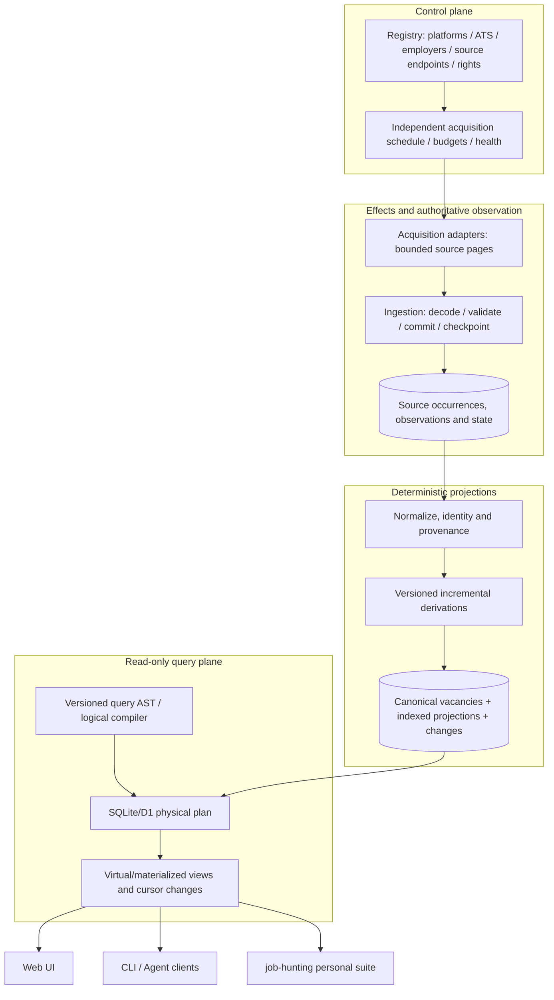

# Norwegian Job Market Index — Technical Product / Project Lead Handoff

- **Status:** RFC 0016 **accepted with amendments A1–A4**; WS-0020@1 **approved** with lead amendments L1–L4 (owner gate 2026-11-01). Later tracers are not yet scoped. See [lead review and gate decisions](#lead-review-and-gate-decisions-2026-11-01).
- **Audience:** Technical product lead, architecture owner, engineering lead, coding agents, independent reviewers.
- **Repository:** `phibkro/job-application-assistant` (review branch `proposal/read-only-norwegian-market-index-2026-11`; [draft PR #21](https://github.com/phibkro/job-application-assistant/pull/21)).
- **Downstream personal client:** `phibkro/job-hunting` ([draft PR #1](https://github.com/phibkro/job-hunting/pull/1)).
- **Authority:** This brief consolidates the proposal; the accepted product vision, accepted RFCs, repository policies and approved WorkScopes remain binding until the human owner makes new gate decisions.
- **Scope:** Product/architecture decisions, existing implementation inventory, risks, explicit follow-up threads, and a bounded engineering execution path. It does **not** claim deployment evidence or authorize destructive migration.

## Lead review and gate decisions (2026-11-01)

Reviewed against `main` at `881eb40` and companion `phibkro/job-hunting` PR #1 head `dd2c8fd`. Verdicts are from reading source; executed evidence comes from WS-0020.

### Proposal claims checked against code

| Claim in this packet | Verdict | Evidence |
| --- | --- | --- |
| Canonical identity = normalized title + employer + location | **Confirmed**, and stronger than stated: the key has no `sourceId`, so two concurrent same-title requisitions *from NAV alone* collapse into one row | `apps/worker/src/corpus/identity.ts:128–148`; `canonical_jobs UNIQUE (canonicalKey)` |
| Occurrence identity = `(sourceId, externalId)` | Confirmed | `identity.ts:138`; `occurrences UNIQUE (sourceId, externalId)` |
| No cron; lazy refresh | Confirmed, with a structural conflict: the gate arms **only on personal reads** (`/api/v1/me/feed`, `/api/v1/me/matches/*`), never on public `/api/v1/jobs` | `infra/alchemy.run.ts:144` (`CRONS = []`); `apps/worker/src/index.ts:193–210` |
| Replay of identical input is a no-op | Unit-level only so far; end-to-end Worker+D1 replay is WS-0020's job | `corpus/decide.test.ts:53`, `corpus/observe.test.ts:45` |
| No general saved-search ledger | Confirmed (`subscriptions` exists, no saved-search table) | `db/schema.sql` |
| Read-only corpus group exists | Confirmed: `listJobs`, `getJob`, `listSources`, `navStatus` carry no `Authenticated` middleware | `apps/worker/src/Api.ts:348–377` |
| Personal mutations live in the same Worker | Confirmed: 20 authenticated mutating endpoints (POST/PUT/PATCH/DELETE) across feed, profile, applications, proposals, documents and account | `Api.ts:387–842` |
| Memory bank is current | **Stale.** It says WS-0016 is uncommitted, but `main` has WS-0016 to WS-0019 integrated (`f233d75`, `f33348b`, `3b2862a`, `881eb40`). `techContext.md` pins Effect `beta.104`; `package.json` pins `4.0.0-rc.108` | `git log`; `package.json` |
| Vision excludes in-app CV/letter writing | **Drifted:** WS-0018 document studio is integrated | `3b2862a` |

### P0 decision status

| ID | Outcome | Binding rule until revisited |
| --- | --- | --- |
| D01 | **Accepted with amendments** A1–A4 ([RFC 0016](../rfcs/0016-read-only-norwegian-market-index.md#amendments)) | The current vision governs existing features. TB-05 must pass before any personal route is retired. |
| D02 | **Interim: freeze** | D1 stays authoritative for existing in-app history; Linear for the job-hunting pipeline. No sync, no migration, and no *new* application-state writers in either repo until a migration WorkScope. |
| D03 | **In progress** via WS-0020@1 | Implementation facts come from pinned code and executed tests, not the memory bank. |
| D04 | **Interim: NAV only** | NAV is the only live source for TB-00 to TB-04. Second sources are fixture-only until a per-source review is recorded. FINN is excluded from the shared index. |
| D05 | **Approved 2026-11-01** | Never merge different `externalId`s within one source. The title/employer/location hash becomes a candidate-blocking key, not an identity. Cross-source matches are versioned `sameAs` links with evidence, keyed on `orgnr` where present. IDs are never recomputed in place: new method versions mint new IDs, with an `id_aliases` redirect table. Deterministic rules come first; Splink is deferred. Implemented in TB-02 (R3). |
| D06 | **Approved 2026-11-01** | Facts are stored per occurrence as `Fact<T>`, with a versioned fusion function to the vacancy. Workload is an HR Open schedule category plus an FTE interval. The 7 states: `Stated · Derived · Negotiable · Conflicting · Unknown · TempUnknown · Unsupported`. FTE reference hours, the preferred range, the overlap rule and the display grouping are variables. |

### Design decisions, 2026-11-01 (owner)

| Topic | Decision | Prior art |
| --- | --- | --- |
| IR naming | schema.org JobPosting vocabulary | schema.org, Google JobPosting guide |
| IR shape | **Homogeneous shape, heterogeneous content.** Every source fills the same closed set of `Fact<T>` attributes. Source variance lives only in `state`, evidence and authority. Unmapped content goes to a uniform `residue: RawClaim[]`, never into per-source keys. | Wikidata statements (somevalue/novalue, ranks); FHIR `data-absent-reason` (`unknown`, `unsupported`, `temp-unknown`) |
| Adapters | Sources are thin importers onto the `SourceAdapter` port; `lower()` keeps `RawListing` consumers unchanged | tsukuri `Importer`/`IrCodec`/`Renderer`; pg-outbox narrow core |
| Hydration (TB-01) | **Option A:** bounded background hydration, with N per run a `Config` variable chosen from measured load | — |
| Stability | Contracts start **experimental** and are promoted on evidence (fitness functions): candidate once two different adapters fit unchanged, stable once an external client depends on it. Observations are kept (as lawful) with `irVersion`; projections are rebuildable; old IR versions decode through pure migrations. | Kubernetes alpha/beta/GA; *Building Evolutionary Architectures* (fitness functions, last responsible moment); effx `migrate.ts` |
| Verification | One `defineSourceConformance(adapter, fixtures)` suite, with one check per numbered guarantee and one deliberately broken twin per check. A source-quirk catalogue as data (`verifiedBy: docs \| fixture \| unverified`). Known-risk pins are deleted when fixed. Property laws over passes. | pg-outbox conformance and mutation controls; file-transfer `declareGuarantees`; pg-txmode catalogue; effx laws |
| Sequencing | Upgrade `effect` to 4.1.0 (WS-0021) **before** building the IR | Owner repos pin 4.1.0 |
| Ownership cost | **Minimize what we maintain: adopt > adapt > build.** Prefer tools and templates that already embody the philosophy (immutable facts, bitemporality, rules, explicit algebra, browsable read-only views) over building them. Every option is scored on owned maintenance: code, ops, upgrades and dependency churn (e.g. the foldkit 0.139 → 0.170 redesign). | Owner decision 2026-11-01 |

**Proposed, not decided: the client API algebra.** REST, RPC, MCP and CLI should be thin interpreters of **one minimal query algebra**. The algebra's constructs, relations and laws are explicit and property-tested. The CQL2-JSON subset (D09) becomes one *surface syntax* that compiles into it. The seed already exists: `packages/domain/src/SetExpression.ts` (Atom/Union/Intersection/Difference + `evaluate`). This goes to a design-spike WorkScope after TB-01, reshaping TB-04.

### Ownership

| Role (`policy/authority.json`) | Holder | May | May not |
| --- | --- | --- | --- |
| Product owner, source-policy owner (D04), client owner (D12) | phibkro | Approve or revise scope; accept RFCs; integrate | — |
| Release owner | phibkro | Deploy, waive, roll back | — (no deploy is authorized in this program yet) |
| Technical lead / supervisor | Lead agent session | Draft WorkScopes, assign, bounded retry, request review | Approve its own gates, deploy, widen scope |
| Implementing actor | One delegated coding agent per Ticket | Execute within the approved WorkScope | Change behavior or scope outside it |
| Independent reviewer | Separate agent with fresh context; gets the diff, not the implementer's summary | Review diff and reproduce evidence; recommend | Accept on the owner's behalf |

### Bounded backlog

One Ticket is active at a time. Each later Ticket gets the next free WorkScope ID (starting at WS-0021) only once its prerequisites hold.

| Ticket | Status | Risk | Falsifier | Must hold before scoping |
| --- | --- | --- | --- | --- |
| TB-00 · WS-0020@1 | **Done:** `b601267`, review ACCEPT WITH NITS (`evidence/WS-0020/review.md`) | R1 | Identical replay moves `sequence`; returned record lacks its source | — |
| WS-0024 JVM stack spike | **Approved, next**: evidence only, no production code | spike | The TS path does as well or better on the same falsifiers | — |
| WS-0021@2 Effect 4.1.0 + foldkit 0.170.0 | **Postponed** until WS-0024 reports (both attempts stopped correctly) | R2 (dependency) | Any test assertion changes, or a semantic difference appears | — |
| TB-01 workload facts (WS-0022) | After WS-0021; experimental IR v0 + NAV importer + workload pass + bounded hydration | R2 (additive schema + API field) | An advert with no stated percentage is excluded as full-time, or 40–80% is reported as exactly 50% | D06 field spec; TB-00 evidence |
| TB-02 second-source identity | Blocked | R3 (canonical IDs, saved snapshots) | Two same-title NAV requisitions stay merged after the change, or a saved job is orphaned | D05 strategy; D04 fixture-only |
| TB-03 change/retraction | Queued | R2 | A closed vacancy still matches an active query via the changes cursor | Stable identity contract (TB-02) |
| TB-04 query AST | Queued | R2 (public contract) | Web and API return different IDs/order for the same AST; an unsupported operator compiles | TB-01 |
| TB-05 independent refresh | Queued; **gates any personal-route retirement** (A2) | R2 + staging release gate | Corpus goes stale with zero personal-feed traffic | D10 design; staging tick evidence (cron dispatch previously failed) |
| TB-06 job-hunting read client | Queued | R2 in the client repo | One vacancy creates two Linear issues; a refresh overwrites human notes | TB-04 stable; D02 freeze holds |

## Executive decision and product thesis

**Proposed mission:** A dependable, provenance-aware, up-to-date, unified **read-only query service for Norwegian employment opportunities**. Aggregate legally permitted source information into a canonical, incrementally maintained corpus, then expose composable queries and views to web, CLI, AI agents and external clients. Success means better coverage, correctness, freshness, intelligibility and usable search—not maximizing applications, engagements or automation.

The system is **domain-specific infrastructure**, taking inspiration from:
- **Distributed information databases:** multiple source authorities, source-specific identities, normalization, canonical views, relational operations and indexes.
- **Build/incremental compilation systems:** versioned inputs, deterministic transformations, dependency invalidation, replay and recomputation.
- **Reactive dataflow:** source changes propagate as changes/retractions to indexed projections and client views.
- **Cybernetic information systems:** measure source freshness, collection costs, coverage/overlap and errors to improve source allocation under fixed access constraints.

Do not build a generic distributed database, build engine or agentic workflow engine. Apply proven ideas to this bounded market-index domain.

### The most important boundary

The shared market index is **read-only from the client's perspective**. It has no client-facing job-application, CV editing, source-configuration mutation or remote-action commands. `POST /query` may be read-only (complex query payload), but **internal writes are essential**: ingestion checkpoints, leases, permitted observations, source health, canonical indexes, cache entries, changes and lawful purge. A query plan is an **ephemeral or rebuildable derivation**, not the only piece of state. External source acquisition is an explicitly authorized effect, never a hidden side effect of a client query.

The existing Job Application Assistant has live application/profile/drafting routes; **do not delete those features or personal data merely because the target boundary excludes them**. Migration and authority require an independent approval and verified alternative in the personal suite.

## What is already documented vs implemented

| Concern | On proposed review branch | Existing code on base `main` | Lead action |
| --- | --- | --- | --- |
| Goal, read-only scope, non-goals, governance | RFC 0016 | Current approved mission is full application assistant | Approve/revise RFC and compatibility approach |
| Logical phase/data/control/query planes | Target architecture | Services distributed through a single Effect Worker | Characterize and retain useful seams |
| Source/platform catalog | Phase contract and policies | `source_catalog`, researched platform CSV, `SourceCatalog` | Add employer/ATS/site relationship model incrementally |
| Acquisition plugin system | Singer/Airbyte-inspired adapter contract | `SourceAdapter`, static adapter registry; only NAV registered live | Reuse; second source only after rights review |
| Ingestion and checkpoints | Transactional, bounded, idempotent | D1, SourceLease DO, ingestion runs/failures, NAV cursor; lazy trigger | Prove commit semantics; plan independent schedule |
| Observation history | Append-oriented logical history with purge | Source occurrences/canonical records; not a general immutable observation ledger | Choose minimum retained evidence and deletion model |
| Canonical vacancy identity | Evidence-backed reconciliation, ambiguous relationship | `deriveCanonicalKey` = normalized title + employer + location | Design safe migration; avoid false merges |
| Workload and structured facts | 40–60% / overlap / negotiable / unknown | Raw listing schema lacks structured extent; simple title/location search | TB-01 end-to-end |
| Incremental derivation engine | Versioned pure functions, fingerprints, equivalence | Canonical sequence/update logic; no general build graph | TB-03 test before abstraction |
| Query compiler/AST | Typed JSON DSL → parameterized SQL, optimizer delegated to D1 | `/api/v1/jobs` basic filters and cursor; not general AST | TB-04 additive versioned read API |
| Views and reactive results | SQL/typed projections + changes-since | Existing basic corpus views/changes and personal feed; no proven general client subscriptions | Characterize removal/retractions, then implement |
| Browser/CLI/personal clients | Read contract and client independence | First-party web plus personal code; `job-hunting` NAV/FINN scripts, Typst and Linear | Maintain parity while switching consumer |
| Source freshness and coverage | Health, overlap, unique relevant contribution | Source state and catalog; no measured multi-source coverage | Introduce instrumentation with second source |
| Deployment | Cloudflare/Alchemy/D1 defaults retained | Local tests/staging claims; production qualification incomplete | Gate live evidence; do not assert production-ready |

The proposal lives in **draft PRs**, not `main`, and **no new redesign code has been implemented**. Existing source can satisfy part of the target independently of these documents. Some older memory-bank statements describe cron-driven ingestion or incremental saved searches; current `scheduled.ts` explicitly says no deployed cron and `db/schema.sql` lacks a general saved-search ledger. Resolve any conflict against current pinned code and executable tests, not optimistic historical documentation.

## Canonical architecture and explicit flow

**Phase distinction:**
1. **Registry** (reviewed configuration and policy): _what sources exist, whom they represent, which channels may be collected, retained and redistributed?_
2. **Acquisition** (external effect): _fetch one bounded, checkpointable page from a permitted source_.
3. **Ingestion** (controlled effect): _validate and transactionally record source state/changes and the next safe checkpoint_.
4. **Storage** (observations and projections): _retain permitted source evidence and efficient rebuildable current indexes_.
5. **Analysis/derivation** (prefer pure): _resolve entities conservatively, extract typed facts, derive changes from versioned inputs_.
6. **Query** (read-only): _compile typed query AST into bounded relational operations and parameterized SQL_.
7. **Views** (virtual or maintained): _answer client questions and expose provenance/freshness and changes/retractions_.
8. **Clients** (separate autonomy): _browse, inspect, compare, subscribe; personal workflow actions happen only in job-hunting_.

Note that **storage spans the pre- and post-analysis boundaries**, and **a view is frequently a query/projection rather than a mandatory extra sequential stage**. Keep concepts separate without creating microservices for them. The chosen default remains **Effect TS v4 + TypeScript Worker + Cloudflare D1/SQLite + SourceLease DO + Alchemy**, not a new deployment architecture.

## Domain semantics that must not be lost

- **Platform vs ATS vs board vs employer vs source**: distinct entities with typed relationships. One ATS can serve many employers; one employer can publish to several boards, its ATS, NAV and a direct career page. Catalog entries are not automatically executable collectors.
- **Listing occurrence vs vacancy**: a source listing has `(sourceId, externalId)` identity; a vacancy is an inferred underlying hiring opportunity with evidence of equivalence. Keep multiple occurrences and provenance; avoid silent false merges.
- **Observation vs projection**: observations represent what was received from a source and when (subject to retention); canonical records reflect the current best derived state, not immutable truth.
- **Field provenance**: include `source / observedAt / sourcePublishedAt / methodVersion / evidence` where allowed; distinguish explicit, inferred, disputed, missing and stale information. AI-produced extraction is only a proposal until grounded and validated.
- **Workload / compensation / seniority / location**: represent percentage intervals, negotiable/unknown/conflicting data and source-specific dates explicitly. Missing percentage ≠ 100%; a 100% advert ≠ negotiable; 40–80% overlaps 40–60% but isn't precisely 50%.
- **Change/retraction**: closing/reopening, source takedown, corrections, identity split/merge and loss of query match must be visible through cursor semantics. Queries of active opportunities cannot be modeled as insert-only streams.
- **Time**: distinguish observed time, source update time, vacancy publication time, expiry and corpus `asOf`; never substitute fetch order for source truth.
- **Lawful retention**: append-only is a logical model, not permission to store/republish removed records indefinitely. Keep erasure/tombstone policy and acknowledge cases where historical full replay is impossible.

## Design invariants and constraints

1. A source adapter is a **capability** only; rights/access/retention policy is independently reviewed. Unknown means not authorized. FINN's existing *personal-scale* watcher does not authorize a public shared collector.
2. A source cursor is advanced only with a successfully committed corresponding batch. Retries and identical replays are semantically idempotent.
3. An unchanged semantic observation must not create a new canonical-change event. Do not confuse receipt time with content change.
4. Derived projections are deterministic for fixed accepted observations, transformation versions and configuration; compare incremental update vs full rebuild on replayable test data.
5. Changes to identity/derivation algorithms are versioned with migration/compatibility evidence. Historical application snapshots must not be stranded.
6. External fetch does not occur during read/query execution. Refresh is separately budgeted, scheduled and observable.
7. Client-facing index endpoints are read-only, bounded and typed. Query compiler cannot execute arbitrary source commands or unconstrained SQL.
8. Source failure, stale corpus, no results, unknown extent and inaccessible record are distinct observable conditions.
9. Personal seeker data and subjective application decisions remain private and outside the **public** corpus. No unreviewed external model transfer of personal content.
10. Source coverage claims report **observed unique contribution and overlap**, not an unsupported census of all Norwegian jobs.
11. Logical phase separation does not imply one deployment/service per phase. Keep a modular monolith until explicit scaling thresholds require otherwise.

## Reuse/adoption research by phase (prior art, not mandatory dependencies)

| Phase | Learn from | Adopt/adapt for current system | Defer until justified |
| --- | --- | --- | --- |
| Registry | Airbyte Connector Builder, declarative manifests | Versioned source manifests, audited permissions, employer/ATS catalog | Large crawler/discovery marketplace |
| Acquisition | Singer SCHEMA/RECORD/STATE, dlt | Existing Effect SourceAdapter, typed pages/cursors/conditional fetch | New generic integration runtime |
| Ingestion | dlt cursor/idempotence, transactional outbox patterns | D1 atomicity, bounded runs/retries, source leases/failure records | Kafka/queues/workflows without evidence |
| Storage | SQL, dbt SCD2, W3C PROV | D1 relational model, versioned permitted evidence and projections | Full immutable event store |
| Analysis | Nix derivations, Salsa red-green, OpenRefine, Splink | Versioned pure derivations, fingerprints, conservative identity, tests | Generic computation graph, probabilistic mass linkage |
| Query | Relational algebra, Apache DataFusion logical plans | Typed JSON AST, safe SQL compiler, SQLite `EXPLAIN QUERY PLAN` | Homemade physical optimizer |
| Views | Datasette, Materialize, Feldera/DBSP | SQL views + monotonic canonical sequence + retractions | Streaming SQL engine, differential dataflow |
| Clients | OpenAPI, typed SDKs | First-party browser + portable API + external agent/CLI/client | Agent-controlled mutations |

Investigate only the specific reference needed by each tracer; require an explicit hypothesis and measurable improvement before adopting a major dependency.

## 4EM / ArchiMate traceability for lead review

The modeling work is **not** another code framework. Use 4EM to ask _why/what/whom/how_ and ArchiMate to depict how business capabilities map onto application and technology responsibilities.

| 4EM concern | Proposed goal/rule/process | ArchiMate view | Verification |
| --- | --- | --- | --- |
| Goals | Reliable access to suitable work with less manual duplication | Motivation / capabilities | Real queries and usable fresh results |
| Business rules | Permissions, read-only access, provenance, privacy | Motivation / constraints | Policy gates, API safety tests |
| Concepts | Employer, platform, listing, observation, vacancy, query | Information structure | Type/schema and identity tests |
| Business processes | Discover → observe → derive → query → act in *separate* personal client | Business process cooperation | End-to-end tracer |
| Actors/resources | Publishers, employers, index operator, job seeker, clients | Business roles and application cooperation | Explicit ownership/access |
| Technical components | Connector, ingestion, D1, derivation, query API, views | Application/technology layered view | Runtime integration and query-plan evidence |

Create additional views when they answer a stakeholder decision, not as an independent diagram maintenance burden.

## Open decision register (threads for the technical lead)

| ID / priority | Decision or investigation | Owner / next concrete action | Decision evidence |
| --- | --- | --- | --- |
| D01 / P0 | **Accept product pivot** and determine which previous RFC/product contracts are superseded | Product owner reviews RFC 0016, explicitly accepts/revises/rejects | Recorded decision, migration/non-goals, approved first WorkScope |
| D02 / P0 | **Authoritative personal application state**: Linear, files, and existing shared D1 overlap | Product + job-hunting lead map all existing writer/readers and privacy requirements | Owner matrix, preservation tests, export and rollback |
| D03 / P0 | **Baseline code/deployment truth**; memory-bank may describe obsolete cron or search features | Engineering lead runs TB-00 at pinned revision | Tests, source-to-client trace, gap report, no production overclaim |
| D04 / P0 | **Source access, redistribution, retention** for NAV, FINN, Jobbnorge and ATS sites | Source-policy owner records per-source access/legal gates; define permitted second live source | Reviewed source facts, URLs, access/retention records |
| D05 / P0 | **Identity correctness and migration** of title/employer/location hash; same-title parallel requisitions | Domain engineer drafts labeled duplicate/nonduplicate examples and compatibility strategy | False-merge tests, explicit equivalence evidence, rollback |
| D06 / P0 | **Employment facts and query semantics**: percent range, negotiability, unknown, salary, seniority, location | Domain + search lead specify typed fields, evidence and triage status | TB-01 test matrix and client-visible result |
| D07 / P1 | **Observation/event retention architecture**: how much raw evidence can be stored and replayed | Data/policy lead define bounded evidence and purge semantics per source | Erasure/closure tests, immutable vs rebuildable table map |
| D08 / P1 | **Incremental derivation vs current update logic** | Domain lead characterize current corpus sequence then compare delta against rebuild | Differential/property tests, transformation version policy |
| D09 / P1 | **Query AST/operators** and correct result/removal cursor semantics | API lead propose v1 AST with explicit limits and SQL compilation | Web/API parity, invalid query tests, query plans |
| D10 / P1 | **Independent refresh** after authenticated-read lazy gate; prior Cloudflare cron dispatch issues | Runtime/ops lead prototype bounded scheduler in staging only with manual alternative | Real stage tick, checkpoint correctness, source freshness |
| D11 / P1 | **Employer/ATS/source discovery registry** and coverage metrics | Registry lead add one real employer/ATS linkage and calculate source overlap | No invented platform relationships, measured marginal contribution |
| D12 / P1 | **Client migration and portability** | job-hunting lead wire one read-only candidate result; preserve Linear/Typst | One external client end-to-end, zero duplicate applications |
| D13 / P1 | **Published API/security shape**: public vs private, rate limits, OpenAPI generation | API/security lead reconcile existing mutations/auth and proposed index read contract | Versioned contract, auth checks, schema-generated client |
| D14 / P2 | **Capacity/operations**: 50k workload, costs, D1 limits, query plans, backups | Ops lead run representative workload with realistic source distribution | Timings/EXPLAIN, freshness SLO, cost telemetry, restore evidence |
| D15 / P2 | **LLM-assisted extraction and query translation** | Domain lead only when deterministic extraction fails a specific fixture | Grounded evidence, model/version, rejection and offline fallback |
| D16 / P2 | **Long-term engine choice** (FTS, Materialize/Feldera, new scheduler) | Architecture lead wait for measured constraints | Quantified bottleneck, comparative PoC, rollback |

Some threads are independently investigable; none authorizes deploying a source or deleting existing features without separate owner approval.

## Tracer-bullet delivery plan (not horizontal layer implementation)

A **tracer** adds the minimum registry → acquisition → ingest → storage → derivation → query → client path needed to deliver one observable outcome. Each gets a WorkScope/Ticket, contract delta, falsifier, tests, evidence and rollback.

| Ticket | Visible outcome | Minimum changes and acceptance | Prerequisite |
| --- | --- | --- | --- |
| **TB-00 / WS-0020@1** (first) | Existing NAV vacancy shown through Worker+D1 and browser/API | Pin commit; characterize real tests, replay no-op, dedup risk, lazy ingestion, state boundaries; write evidence and next Ticket; **no behavior/schema changes** | D01 owner acceptance + WorkScope approval |
| **TB-01** | Query Oslo 40–60% roles, distinguishing explicit/negotiable/unknown | Add typed workload field, permitted extraction, D1 projection, query filter and UI; fixtures 50%, 40–80%, 100%, negotiable, unknown, conflicting | TB-00; domain contract owner |
| **TB-02** | Two source sightings correctly become one evidenced vacancy; two distinct requisitions stay separate | One policy-permitted second source and fixture, employer/source associations, reconciler, coverage view; no false merges in labeled fixtures | D04/D05 |
| **TB-03** | Changed/closed/reopened vacancies propagate without rescanning whole corpus | Derivation fingerprint/version, incremental vs rebuild equivalence, query removal/retractions, retry atomicity | Stable observation/identity contract |
| **TB-04** | Same validated declarative query works through web and API/CLI | Versioned JSON AST, compiler and param SQL, bounded paging, query plan/contract tests | TB-01 and existing API |
| **TB-05** | Source stays fresh with zero user traffic | Scheduled independent collection, source health, staged dispatch proof, safe rollback | D04/D10 |
| **TB-06** | Personal `job-hunting` pipeline imports one result as a candidate, not a mutation of corpus | Read-only SDK/adapter, preserve Linear and Typst, no duplicate Tickets, closure updates not overwriting notes | Stable external API and identity |

The order is a **value-driven default**, not a waterfall. Start TB-00 then TB-01 for immediate user value. In parallel, **research** source-policy and identity examples without coding a second source. Tighten remaining order after baseline evidence.

### Every Ticket must contain

- A single user-visible outcome plus a falsifier.
- Pinned source revision, explicit scope and allowed capabilities.
- Domain/Effect Schema and API contracts changed, migration compatibility, and data ownership.
- One end-to-end test spanning all required phases; negative/adversarial fixture.
- Source permission and retention assessment when applicable.
- Measured plan/cost/freshness where relevant; no invented thresholds.
- Rollback/rebuild instructions and exact test evidence; human/independent review decision.

## Engineering workflow and authority

1. Product lead reviews [RFC 0016](../rfcs/0016-read-only-norwegian-market-index.md), [architecture](../architecture/read-only-market-index.md), [tracer roadmap](../architecture/market-index-tracers.md) and this handoff. Distinguish agreed conversational intent from **formally accepted** repository decisions.
2. Decide D01 and first authority gate; document acceptance or revisions in the RFC. Do **not** silently edit the approved current [vision](vision.md), delete legacy code, or merge a proposed scope as implementation proof.
3. Approve [WS-0020@1](../../../work/WS-0020-r1-market-index-baseline.md) and [execution plan](../../../work/WS-0020-r1-execution-plan.md). It is a characterization Ticket; broad behavior changes require a new one.
4. Assign **one tracer at a time** to an engineering coding agent. Agent reads `AGENTS.md`, six memory-bank files and [coding-agent handoff](../../../work/HANDOFF-market-index.md) plus its approved WorkScope.
5. Require tested code + evidence + decision log in a PR. Architecture changes and public schema/ID migration receive independent review.
6. Only after baseline confirmation should the lead accept larger scope: source policy, migration of personal features, scheduled cloud refresh, read API and client integration.
7. Operate one canonical change/decision log. Do not let memory-bank summaries overwrite accepted RFCs or tested code; update summaries *after* integration.

### Definition of ready for beginning development

- Proposed RFC reviewed with explicit owner outcome.
- TB-00 WorkScope approved; exact branch/commit pinned.
- Local environment and tests can be run without production credentials.
- No destructive API/DB/module migrations included.
- Baseline characterization and source policy evidence path identified.
- Reviewer assigned, rollback and stop conditions understood.

### Definition of done for a tracer

- One complete client-visible journey exists and its falsifier has been tested.
- Invariants hold at the pinned revision; tests capture source fixture and a negative case.
- Changes are bounded, reviewed, independently reproducible, and backed by migration/rollback where applicable.
- Actual local/staging/production evidence levels are clearly distinguished.
- Remaining gaps and next Ticket are recorded; no unapproved scope widening.

## Open questions for future product research (not immediate blockers for TB-00)

- Which high-value employer/ATS sources materially add **unique** relevant jobs beyond NAV, FINN and Jobbnorge? Track per-source overlap, cost, freshness, permission and precision.
- Is a dedicated `Employer/RecruitmentPlatform/Source` graph best represented relationally (default) or through specialized graph operations (defer)?
- Should typed semantic enrichments be stored as fields, derived views or query-time interpretation? Prefer evidence-backed reusable fields for frequent predicates.
- Can source onboarding be declarative for common HTTP/JSON feeds while keeping manual static registration of executable adapters? Separate configuration from code loading.
- Do reactive clients need per-query persisted materialization, or does cursor polling over canonical changes suffice? Measure first.
- How will partial/contradictory vacancy fields appear in results without giving false precision?
- How will future source removal or parser-version upgrade rebuild projections without violating retention/identity constraints?
- What incentives and governance will keep a public index accurate and avoid engagement-optimized recommendation behavior?
- What is a feasible legal/technical interface for FINN-exclusive jobs when the shared collector cannot fetch them automatically? Client-side link-out/manual discovery remains an alternative.
- Which query features are actually demanded by clients? Begin with workload/location/role/freshness and validated typed filters, not a universal SQL frontend.

## Links and handoff instructions

**Primary source documents (review branch):**
- [Proposed RFC 0016](../rfcs/0016-read-only-norwegian-market-index.md)
- [Detailed technical architecture and patterns](../architecture/read-only-market-index.md)
- [Tracer-bullet roadmap](../architecture/market-index-tracers.md)
- [Coding-agent handoff](../../../work/HANDOFF-market-index.md)
- [WS-0020 first WorkScope](../../../work/WS-0020-r1-market-index-baseline.md)
- [WS-0020 execution plan](../../../work/WS-0020-r1-execution-plan.md)
- [job-hunting client review](https://github.com/phibkro/job-hunting/pull/1)
- [Existing source history and accepted vision](vision.md)

**Copy-ready lead instruction:**

> Act as technical product/project lead for the proposed Norwegian Job Market Index redesign. Start from draft PR #21 in `phibkro/job-application-assistant` and companion draft PR #1 in `phibkro/job-hunting`. Review RFC 0016, the target architecture, this decision register and the tracer program against the exact existing code. Distinguish documented proposals, implemented source and verified local/staging/production behavior. First reconcile product scope, state ownership and the approval gate. Prepare an actionable, risk-ranked decision record and authorize only the bounded TB-00 / WS-0020 characterization after the owner has accepted it. Delegate end-to-end tracer Tickets sequentially with typed contracts, tests, evidence, stop conditions and rollback. Do not delete current application features, change stored IDs, scrape contested sources or deploy without explicit authority. Keep the indexer client-facing read-only and the personal job-hunting workflow separate.

**Final note:** This packet is a *decision-ready proposed target* and engineering handoff, not proof the target is implemented. The developer's first task should be to verify existing source behavior before extending it.
